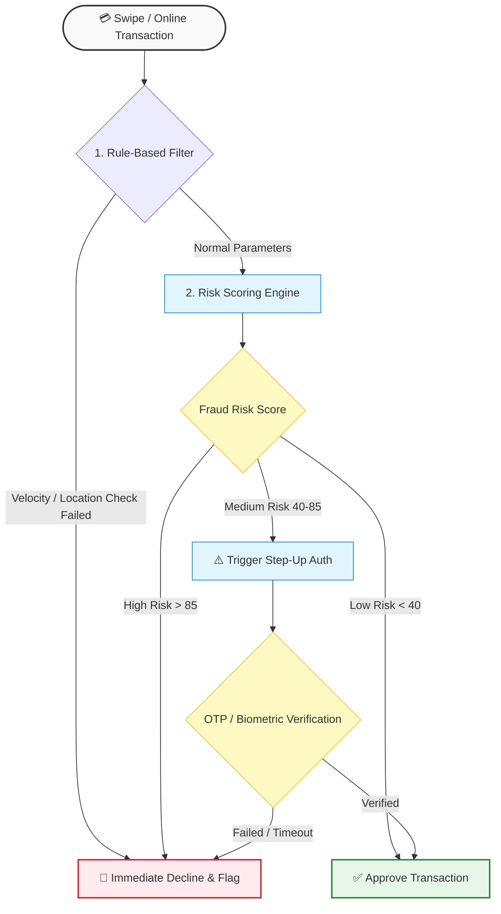

# 💳 Credit Card Fraud Analytics (BRD)

**Project Goal:** Identifying unusual spending behavior and mitigating transaction risks using SQL database analytics and interactive data modeling.

### 📁 Project Deliverables
* [📄 Business Requirement Document (BRD PDF)](BRD_CC%20Fraud%20Analytics%20-%20Divya%20Jayapall.pdf)
* [🔍 SQL Database Analytics Queries](CC_Fraud_analysis_SQLDB_queries_Divya.sql)
* [📊 Interactive Power BI Dashboard File](CC_Fraud_analysis_PBI_Dashboard.pbix) *(Download to view locally)*

## ⚙️ Core Fraud Analytics Architecture

## 📊 Dashboard Preview

